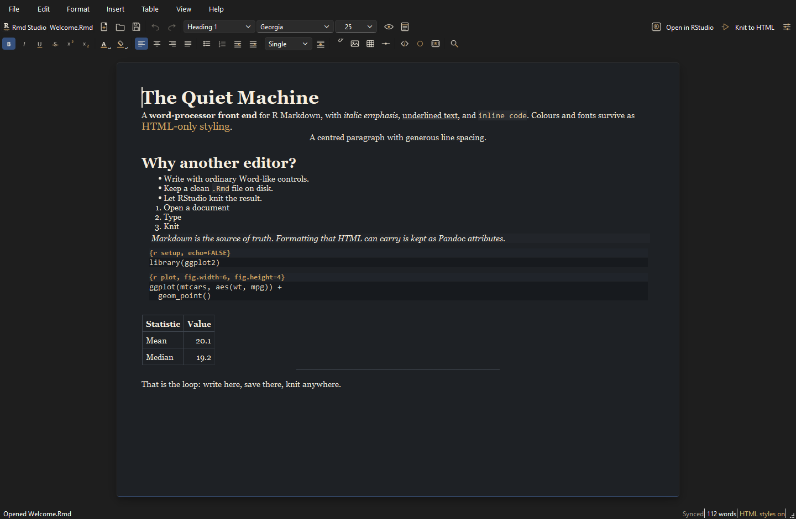
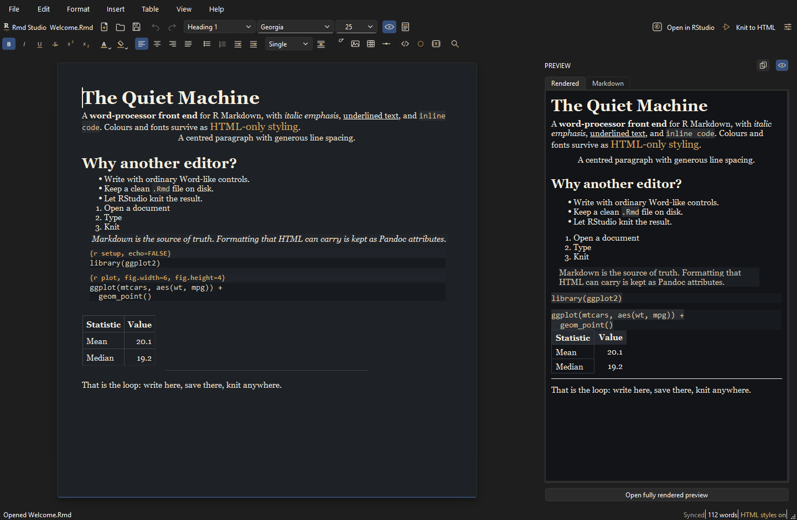

# Rmd Studio

A graphite, word-processor style front end for R Markdown on Windows.

Write in a rich page with Word-like controls. Rmd Studio translates the document
into a normal `.Rmd` file continuously, so RStudio can knit it. The editor is
dark graphite with éclair / parchment text and a caramel accent.





## Quick start

**Built app:** `release\Rmd Studio.exe`

It is a self-contained 38 MB executable. Windows may show a SmartScreen warning
because it is locally built and unsigned — choose *More info → Run anyway* if
you trust it.

**From source:**

```powershell
python -m venv .venv
.\.venv\pip install -r requirements-dev.txt
.\.venv\python launcher.py
```

## What it does

- Rich page editor with headings, bold, italic, underline, strike-through,
  superscript, subscript, font family, size, text colour, highlight, alignment,
  indent, line spacing and paragraph spacing.
- Bullet and numbered lists, quotes, tables, links, images, horizontal rules.
- R code chunks with a chunk-options dialog, inline code and inline R.
- YAML front-matter editor (title, author, output, CSS, …).
- Continuous autosave to `.Rmd`, with external-change detection and conflict
  resolution for files that are also open in RStudio.
- Generated Markdown pane and a **Rendered preview** that runs Pandoc only (no R
  code execution) to show the document in a browser.
- **Open in RStudio** and **Knit to HTML** (runs `rmarkdown::render` locally).
- Find & replace, undo/redo, word count, recent files, dark title bar.

## The important limitation

R Markdown is a semantic text format. It has no concept of a font family,
font size, colour, highlight or line spacing. Rmd Studio solves this in two
layers:

| Layer | Stored as | Renders in |
|---|---|---|
| Semantics: headings, bold, italic, lists, tables, links, code, quotes | Normal Markdown / R Markdown | HTML, PDF, Word |
| Presentation: fonts, sizes, colours, highlights | Pandoc attribute spans, e.g. `[text]{style="font-size: 14pt; color: #d3a35f"}` | HTML output only |
| Presentation: alignment, line spacing, paragraph spacing | Pandoc fenced divs with `style="..."` | HTML output only |

So "translate fonts and spacing" is feasible, but only HTML output will *show*
those extra properties. A PDF or Word renderer will ignore the CSS-style
attributes. The app states this in the UI and has a **View → Preserve fonts,
colours and spacing** toggle for producing clean, Markdown-only output.

Do not use arbitrary fonts/colours if the final document must be a PDF with
exact typography; use the R Markdown/LaTeX theme or a CSS file instead.

## RStudio workflow

1. Save the document once (`Ctrl+S`) into the folder where the `.Rmd` belongs.
2. Keep writing. After a short pause (800 ms by default) the `.Rmd` file is
   rewritten atomically.
3. RStudio normally notices the external change and offers to reload the file.
   If it does not, click the file's tab and reload it, or use **Open in RStudio**.
4. Press **Knit to HTML** in Rmd Studio, or knit from RStudio.

If RStudio and Rmd Studio both have unsaved changes, the app detects the
external hash and asks whether to reload, overwrite or save a copy. It never
silently overwrites an external edit.

Rmd Studio does not inject code into RStudio's R session. It writes files and
launches `Rscript` / RStudio, which is reliable and keeps the app independent.

## Importing existing documents

Opening an existing `.Rmd` uses the Pandoc bundled with RStudio. YAML and R code
chunks are preserved exactly; prose is rendered into the rich editor. R Markdown
constructs that do not have a visual equivalent (citations, cross-references,
raw LaTeX, footnote bodies, complex divs) are approximated or kept as raw text,
with a note in the preview panel. Save a copy if a document relies heavily on
those features.

Pasting from Microsoft Word uses the HTML clipboard. Word's font/colour/spacing
noise is stripped while bold, italic, headings, lists and tables are kept; use
the ribbon controls to reintroduce any presentation you actually want. Opening
`.docx` files directly is planned but not part of this build.

## Keyboard shortcuts

| Shortcut | Action |
|---|---|
| `Ctrl+N/O/S/Shift+S` | New / open / save / save as |
| `Ctrl+B/I/U` | Bold / italic / underline |
| `Ctrl+Shift+X` | Strike-through |
| `Ctrl+K` | Link |
| `Ctrl+Alt+1…4` | Heading 1–4 |
| `Ctrl+Alt+0` | Normal paragraph |
| `Ctrl+Shift+7/8` | Numbered / bullet list |
| `Ctrl+Alt+C` | R code chunk |
| `Ctrl+Alt+R` | Inline R expression |
| `Ctrl+Shift+P` | Generated Markdown pane |
| `Ctrl+Shift+M` | YAML front matter |
| `Ctrl+F` / `Ctrl+H` | Find / replace |
| `Ctrl+Alt+O` | Open in RStudio |
| `Ctrl+Alt+K` | Knit to HTML |
| `F1` | Quick guide |

## Project layout

```
rmdstudio/
  app.py            application entry point, dark title bar, selftest
  main_window.py    ribbon, page, preview, files, RStudio and knit actions
  editor.py         QTextEdit subclass: paste/drop images, chunk Enter/Tab
  theme.py          graphite + éclair theme
  icons.py          QPainter-drawn icons and logo
  dialogs.py        link/image/table/chunk/spacing/find/settings/about
  sync.py           atomic writes, hashing, external-change watcher
  external.py       RStudio / Rscript / Pandoc discovery
  model/
    style.py        shared constants and QTextFormat properties
    blocks.py       rich-document operations
    markdown.py     QTextDocument → R Markdown serializer
    importer.py     Rmd → QTextDocument importer (Pandoc AST)
samples/            bundled welcome document
tests/              serializer, importer, sync and UI selftests
tools/              icon generator
```

## Build

```powershell
.\.venv\python build.py
```

This runs PyInstaller with `RmdStudio.spec` and copies the result to
`release\Rmd Studio.exe`. The build is unsigned. The app has no telemetry and
makes no network requests; RStudio/Pandoc/Rscript are invoked only for the
explicit buttons.

Built with Qt/PySide6 (LGPL-3.0); PyInstaller bundles the Qt libraries needed at
runtime.

## Current limits / next steps

- Spell check is not included yet.
- Footnotes, citations, cross-references, merged table cells and arbitrary
  LaTeX are preserved only approximately on import.
- Opening `.docx` directly (rather than pasting) is not implemented.
- A live embedded rendered preview would need QtWebEngine or a small local HTML
  viewer; currently the preview opens in the default browser.
- Word-like page pagination/printing is not simulated; R Markdown is the print
  source of truth.
