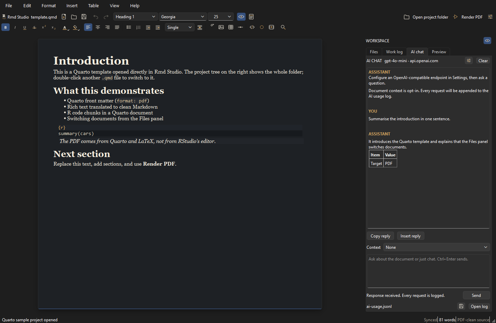

# Rmd Studio

A graphite, word-processor style **Markdown** editor for Windows, with optional
Quarto and R Markdown publishing, a project file browser and a dedicated work
log.

Write in a rich page with Word-like controls. Rmd Studio writes ordinary
Markdown continuously. New documents are plain `.md` files with no YAML front
matter and no PDF controls. Switch to **R Markdown** or **Quarto** only when you
need YAML, R chunks, citations or PDF rendering. RStudio is optional. The
editor is dark graphite with éclair / parchment text and a caramel accent.




## Quick start

**Installer:** run `release\INSTALL.cmd` (recommended). It stages the Inno Setup
installer in the system temp folder; this avoids a setup-path problem when the
folder contains non-ASCII characters. On a plain ASCII path you can also run
`release\Rmd Studio Setup 0.5.0.exe` directly.

**Portable:** `release\Rmd Studio.exe` is self-contained and needs no Python
install.

Windows may show a SmartScreen warning because the app is locally built and
unsigned — choose *More info → Run anyway* if you trust it.

## What it does

- **Markdown mode (default):** `Ctrl+N` starts a plain `.md` document with no
  YAML and no PDF/R/Quarto controls. Bold, italic, headings, lists, tables,
  links and images are written as normal Markdown, and autosave writes straight
  back to the `.md` file.
- **R Markdown and Quarto modes:** use **File → New R Markdown document** or
  **New Quarto document** when you need YAML, R chunks, citations or PDF output.
  Opening a `.Rmd` or `.qmd` file switches to the matching mode automatically.
- Rich page editor with headings, bold, italic, underline, strike-through,
  superscript, subscript, font family, size, text colour, highlight, alignment,
  indent, line spacing and paragraph spacing.
- Bullet and numbered lists, quotes, tables, links, images, horizontal rules.
- R code chunks with a chunk-options dialog, inline code and inline R (R
  Markdown/Quarto mode).
- YAML front-matter editor (title, author, output, CSS, …) in R Markdown/Quarto
  mode. Existing `.md` front matter is preserved but hidden.
- **Project file browser:** open a folder, see its full tree in the Files tab,
  and double-click a `.md`, `.qmd` or `.Rmd` file to switch documents. Project
  roots are detected from `_quarto.yml`, `.Rproj` or `.git`.
- **Quarto support:** open a `.qmd` template, create a new Quarto document, and
  render it with the standalone Quarto CLI.
- **PDF-clean output by default:** fonts, colours, highlights, alignment and
  spacing stay in the editor unless you explicitly enable the HTML styling
  layer. Source stays idiomatic for Quarto (`format: pdf`) or R Markdown
  (`output: pdf_document`).
- **Work log panel** beside the page. Type an entry, press Add entry or
  `Ctrl+Enter`, and it is appended immediately to the designated log file with
  a timestamp. The default is `build.log` next to the document; choose any
  `.md`, `.log` or `.txt` file with the save button in that tab.
- **AI chat** with optional document context, formatted insertion at the cursor,
  secure DPAPI key storage, and automatic append-only `ai-usage.jsonl` logging
  of every request, error and cancellation.
- **Zotero citations** in R Markdown/Quarto mode: link a Zotero/Better BibTeX
  `.bib` or CSL `.json` export, search entries, and insert `[@key]` or multi-key
  citations. The bibliography is added to YAML automatically.
- **Render PDF** in R Markdown/Quarto mode, with a progress dialog and the render
  log on failure. If no LaTeX engine is installed, the app offers to install
  TinyTeX (including `soul` for underline/strikeout support) or lets you point
  at an existing MiKTeX/TeX Live `pdflatex`.
- Continuous autosave, external-change detection and conflict resolution for
  files also open in another editor.
- Generated Markdown pane, rendered HTML preview, find & replace, undo/redo,
  word count, recent files, dark title bar.

## Markdown, PDF and formatting policy

In **Markdown mode**, the source is a plain `.md` file:

- no YAML is added to a new document
- headings, emphasis, lists, quotes, tables, links and images become ordinary
  Markdown
- font/colour/spacing choices stay in the editor
- PDF, R chunk and citation controls are hidden

If you open an existing `.md` that already has YAML front matter, Rmd Studio
preserves it but keeps it hidden so the file round-trips safely.

In **R Markdown/Quarto mode**, the final target is a PDF rendered by Quarto or
rmarkdown. The default source is:

- For `.qmd`: YAML `format: pdf`
- For `.Rmd`: YAML `output: pdf_document`
- normal Markdown for structure and emphasis
- no font/colour/spacing spans or fenced divs
- R chunks exactly as entered

This is what the PDF layer understands:

| Feature | PDF |
|---|---|
| Headings, paragraphs, lists, quotes | yes |
| Bold, italic, strike-through | yes |
| Underline | yes, via `[text]{.underline}` and the `soul` LaTeX package |
| Superscript/subscript | yes |
| Tables, links, images, code chunks | yes |
| Font family/size/colour | **no** — editor-only |
| Highlight colour | **no** — editor-only |
| Paragraph alignment/line spacing | **no** — editor-only |

The optional **View → Preserve fonts, colours and spacing** setting writes the
presentational layer as Pandoc HTML attributes/fenced divs. That is useful for
HTML previews, but PDF ignores it. Keep it off for PDF work.

### LaTeX requirement

PDF rendering needs a LaTeX installation. The app detects `pdflatex` on PATH,
TinyTeX, MiKTeX and TeX Live. If none is found, **Render PDF** offers to install
TinyTeX into `%LOCALAPPDATA%\RmdStudio\TinyTeX`. It also installs `soul` so
underlines and strike-through render in PDF.

You can also install TinyTeX/MiKTeX/TeX Live yourself and set the `pdflatex`
path in **Settings**. The first PDF render may take longer while LaTeX packages
are located.

## Work log

RStudio's Build pane is output-only; it does not expose a standard input log
file. Rmd Studio therefore writes a dedicated, append-only build log at the file
you designate:

- Default: `<folder of the .Rmd>/build.log`
- Choose another path: the save button in the **Work log** tab
- A relative choice is stored relative to the document folder; an absolute path
  is used as-is.
- Markdown files get entries like:
  ```md
  - **2026-11-23 14:30:05** — Checked the methods section against the data.
  ```
- `.log` / `.txt` files get `[2026-11-23 14:30:05] ...` entries.
- Entries are appended, not rewritten, so the log behaves like a journal.

A `.md` destination produces Markdown bullets; `.log` and `.txt` destinations
use plain timestamped lines. Any other extension uses the plain format.

## AI chat and AI usage log

The **AI chat** tab talks to any OpenAI-compatible chat-completions endpoint:

- OpenAI
- OpenRouter
- LM Studio or Ollama’s OpenAI-compatible server
- a custom local or institutional endpoint

Set the preset, base URL, model and API key in **Settings**. The key is encrypted
with Windows DPAPI for the current user; it is never written to the AI log.
Localhost endpoints do not require a key.

The chat can include **no document context**, the **current selection**, or the
**whole document** (truncated at 16,000 characters). Every request can be logged
automatically to `ai-usage.jsonl` (default: next to the current project or
document; configurable in the tab). The log is append-only JSON Lines and
contains:

- timestamp, request id, model, endpoint, status and latency
- prompt messages and the full response, if full-content logging is enabled
- token usage returned by the provider
- context type, document name, and error/cancellation details

Failed and cancelled requests are logged too. The API key is never included.
Use **Insert reply** to place the last answer at the editor cursor as formatted
text, or **Copy reply**.

The AI log can contain confidential document text. Turn off **Log full prompt and
response text** in Settings if you only need metadata. Requests are sent over
the network only when you press Send; there is no background AI activity.

## Zotero citations

Zotero citations are available in **R Markdown/Quarto mode**, where they can be
stored in YAML. The citation action is hidden in Markdown mode.

Rmd Studio reads a bibliography file exported from Zotero:

- **Zotero + Better BibTeX**: use a `.bib` auto-export
- **Plain Zotero**: export the library/collection as CSL JSON and use the `.json`

Open **Insert → Zotero citation…** (or press `Ctrl+Alt+Z`), choose the
bibliography if it is not linked yet, search by author/title/year/key, and
select one or more entries. The app inserts `[@key]` or `[@key1; @key2]` at the
cursor and adds a `bibliography:` entry to YAML if one is missing.

Link the bibliography permanently in **Settings → Zotero bib**. The file is read
fresh each time the citation dialog opens, so Better BibTeX auto-exports stay
current without a background service. The picker does not require a running
Zotero process.

## Standalone workflow

1. **File → Open project folder** (`Ctrl+Shift+O`) picks the project root, or
   open a Markdown/Quarto/R Markdown file directly and the root is detected.
2. Use the **Files** tab to browse the folder. Double-click a `.md`, `.qmd` or
   `.Rmd` document to switch to it.
3. Write. After a short pause (800 ms by default) the source file is rewritten
   atomically. A Markdown document is saved directly as `.md`.
4. For `.qmd` or `.Rmd`, press **Render PDF**. Quarto handles `.qmd`; rmarkdown
   handles `.Rmd`. Markdown mode has no render button by design.
5. The work log and source sit next to the project. No IDE is required.

If another editor or process changes the file, the app detects the external hash
and asks whether to reload, overwrite or save a copy. It never silently
overwrites an external edit.

Rmd Studio does not inject code into an IDE session. It writes files and launches
the standalone Quarto CLI or `Rscript`, which keeps the app independent.

## What you need installed

Plain Markdown editing needs none of these. They are required only for rendering
or importing the corresponding formats:

- **R / Rscript** for R chunks and rmarkdown files.
- **Quarto CLI** for `.qmd` files (bundled with RStudio if present, otherwise
  install Quarto from quarto.org).
- **Pandoc** for importing existing Markdown and the HTML preview (bundled with
  Quarto or RStudio, or install standalone).
- **LaTeX** for PDF output (TinyTeX can be installed from the Render PDF
  prompt; MiKTeX/TeX Live also work).

RStudio is optional. Install standalone Quarto and Pandoc if it is not present.

## Importing existing documents

Opening an existing `.md`, `.qmd` or `.Rmd` uses Pandoc and selects the matching
mode. YAML and code chunks are preserved exactly; prose is rendered into the
rich editor. Constructs that do not
have a visual equivalent (citations, cross-references, raw LaTeX, footnote
bodies, complex divs) are approximated or kept as raw text, with a note in the
preview panel. Save a copy if a document relies heavily on those features.

Pasting from Microsoft Word uses the HTML clipboard. Word's font/colour/spacing
noise is stripped while bold, italic, headings, lists and tables are kept; use
the ribbon controls to reintroduce any presentation you actually want. Opening
`.docx` files directly is planned but not part of this build.

## Keyboard shortcuts

| Shortcut | Action |
|---|---|
| `Ctrl+N` | New Markdown document |
| `Ctrl+O` / `Ctrl+S` / `Ctrl+Shift+S` | Open / save / save as |
| `Ctrl+Alt+Q` | New Quarto document |
| `Ctrl+Shift+O` | Open project folder |
| `Ctrl+B/I/U` | Bold / italic / underline |
| `Ctrl+Shift+X` | Strike-through |
| `Ctrl+K` | Link |
| `Ctrl+Alt+Z` | Insert Zotero citation (R Markdown/Quarto) |
| `Ctrl+Alt+1…4` | Heading 1–4 |
| `Ctrl+Alt+0` | Normal paragraph |
| `Ctrl+Shift+7/8` | Numbered / bullet list |
| `Ctrl+Alt+C` | R code chunk (R Markdown/Quarto) |
| `Ctrl+Alt+R` | Inline R expression (R Markdown/Quarto) |
| `Ctrl+Shift+P` | Workspace panel (Files / Work log / AI chat / Preview) |
| `Ctrl+Enter` | Send an AI chat message |
| `Ctrl+Shift+M` | YAML front matter (R Markdown/Quarto) |
| `Ctrl+F` / `Ctrl+H` | Find / replace |
| `Ctrl+Alt+K` | Render PDF (R Markdown/Quarto) |
| `F1` | Quick guide |

## Project layout

```
rmdstudio/
  app.py            application entry point, dark title bar, selftest
  main_window.py    ribbon, page, project tree, log, preview, render
  editor.py         QTextEdit subclass: paste/drop images, chunk Enter/Tab
  theme.py          graphite + éclair theme
  icons.py          QPainter-drawn icons and logo
  dialogs.py        link/image/table/chunk/spacing/find/settings/about
  logbook.py        designated build-log path + append-only entries
  chat_panel.py     AI tab, context, insertion and request logging
  ai_client.py      OpenAI-compatible HTTP client
  ai_log.py         append-only ai-usage.jsonl schema/path helpers
  ai_settings.py    AI defaults and provider presets
  credentials.py    Windows DPAPI API-key encryption
  citations.py      BibTeX/CSL reader and Zotero citation picker
  sync.py           atomic writes, hashing, external-change watcher
  external.py       Quarto / Rscript / Pandoc / pdflatex discovery
  model/
    style.py        shared constants and QTextFormat properties
    blocks.py       rich-document operations
    markdown.py     QTextDocument → Markdown/Pandoc serializer
    importer.py     Markdown/Rmd/Quarto → QTextDocument importer (Pandoc AST)
samples/            Markdown and R Markdown welcome samples, Quarto project
tests/              serializer, importer, sync, log and UI tests
installer/          Inno Setup script
tools/              icon generator and Authenticode signing script
```

## Build

```powershell
.\.venv\python build.py
```

This runs PyInstaller with `RmdStudio.spec`, copies the result to
`release\Rmd Studio.exe`, compiles `installer\RmdStudio.iss` with Inno Setup if
installed, and writes `release\INSTALL.cmd`.

Development setup, tests, installer details and optional code signing are
documented in [CONTRIBUTING.md](CONTRIBUTING.md).

Built with Qt/PySide6 (LGPL-3.0); PyInstaller bundles the Qt libraries needed at
runtime. The app has no telemetry and makes no network calls except when you
explicitly install TinyTeX, open an external preview, or send an AI chat
message. Quarto/Pandoc/Rscript are invoked only for explicit actions.

## Current limits / next steps

- AI chat uses non-streaming OpenAI-compatible requests. Anthropic/Gemini native
  APIs need an OpenAI-compatible gateway such as OpenRouter. It never edits or
  runs code automatically.
- The AI usage log is a local file, not a tamper-proof institutional audit trail.
- Zotero integration reads a `.bib`/CSL JSON export; it does not query a running
  Zotero library through an API.
- Spell check is not included yet.
- Markdown mode intentionally has no YAML, R chunk, citation or PDF controls.
  Switch to R Markdown/Quarto for those features.
- Footnotes, citations, cross-references, merged table cells and arbitrary
  LaTeX are preserved only approximately on import.
- Opening `.docx` directly (rather than pasting) is not implemented.
- A live embedded rendered preview would need QtWebEngine or a small local HTML
  viewer; currently the preview opens in the default browser.
- Word-like page pagination/printing is not simulated; the generated Markdown,
  Quarto or R Markdown source is the print source of truth.
- Release binaries are unsigned; Windows SmartScreen may warn.
- Standalone R, Quarto, Pandoc and LaTeX are required for `.qmd` rendering,
  previews and PDF output.
